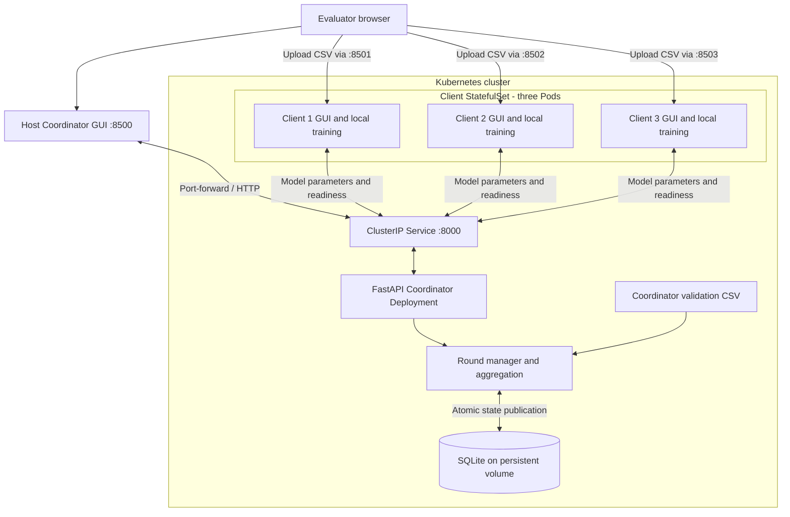

# TrustFed

**Trust-Aware Federated Learning for Decentralised Scam Message Detection**

*CSC3104 Cloud and Distributed Computing | Group 13 | AY 2026–2027*

Singapore Institute of Technology and University of Glasgow

    

> Learn collaboratively. Assess contributions before trusting them.

TrustFed is a cloud-native federated-learning prototype that enables independent clients to train a shared message classifier without transmitting their raw training messages to the central coordinator. It combines trust-aware aggregation with deadline-driven distributed coordination, persistent model publication and an interactive browser-based command centre.

**Key result:** Under a simulated scam suppression attack, TrustFed achieved an F1-score of **74.44%**, compared with **37.41%** for Federated Averaging (FedAvg), detecting 41 additional positive messages on the same evaluation set without increasing false positives.

## Contents

- [Problem and solution](#problem-and-solution)
- [Architecture](#architecture)
- [Experimental evaluation](#experimental-evaluation)
- [Quick start](#quick-start)
- [Run normal training](#run-normal-training)
- [Reproduce attack experiments](#reproduce-attack-experiments)
- [Automated tests and recovery](#automated-tests-and-recovery)
- [Troubleshooting](#troubleshooting)
- [Cleanup](#cleanup)
- [Experimental scope](#experimental-scope)
- [Team](#team)

## Problem and solution

Telecommunications providers and financial institutions could benefit from collaborative scam detection, but sharing raw customer messages introduces confidentiality and governance concerns. Federated learning keeps training records at their respective clients, although the shared model may still be influenced by corrupted local training data.

TrustFed addresses this challenge through three mechanisms:

| Challenge | TrustFed approach |
| --- | --- |
| Centralising sensitive training data | Local training with model parameter exchange rather than raw training-message exchange |
| Unreliable or poisoned contributions | Validation F1, historical trust scores, bounded sample weighting and conditional update rejection |
| Incomplete or interrupted distributed training | Round deadlines, readiness checks, a minimum accepted-update requirement and persistent global model state |

The prototype uses spam classification as a proxy for scam detection. It illustrates a possible collaborative use case rather than a deployed commercial fraud-detection service.

## Architecture



| Component | Technology | Responsibility |
| --- | --- | --- |
| Coordinator | Python, FastAPI, Uvicorn | Registration, readiness, rounds, submission validation and global model publication |
| Clients | Three Kubernetes StatefulSet Pods | CSV ingestion, local training and model submissions |
| Classifier | scikit-learn SGDClassifier, hashing vectoriser | Shared logistic text classifier |
| Aggregation | FedAvg / TrustFed | Sample-weighted baseline or validation-dependent trust weighting |
| Persistence | SQLite, Kubernetes PVC `trustfed-pvc` | Committed model, trust scores, round state and registrations |
| Interfaces | Browser GUIs | Client uploads, coordinator controls, trust scores and evaluation |
| Deployment | Docker and Kubernetes | Containerised services, stable client identities and service discovery |

The Coordinator GUI runs on the host computer; each Client GUI and its training process run inside the corresponding Kubernetes Pod. The evaluation CSV is processed by the host GUI backend, which retrieves the published model through the API. See [GUI Kubernetes integration](docs/GUI_KUBERNETES_INTEGRATION.md) for further details.

### Federated learning workflow

1. Each client uploads its local CSV, registers and reports readiness.
2. The coordinator starts a round for the ready participants.
3. Clients download the current global model and train independently.
4. Each client submits its updated model parameters and sample count before the deadline.
5. The coordinator validates contributions and applies the selected aggregation policy.
6. If at least three updates are accepted, the new model is published and its version increases. Otherwise, the previous committed model is retained.
7. After five successful rounds, the GUI enables final model evaluation without retraining.

### Aggregation policies

| Feature | FedAvg | TrustFed |
| --- | --- | --- |
| Weighted full-model averaging | Yes | Yes |
| Protocol and parameter validation | Yes | Yes |
| Candidate validation F1 | No | Yes |
| Historical trust scores | No | Yes |
| Sample-count cap | No | Yes |
| Joint update-magnitude and quality rejection | No | Yes |
| Minimum accepted updates | 3 | 3 |

Trust scores range from 0 to 1 and estimate a client's contribution quality on the coordinator's validation distribution. They are not scam probabilities, connection-health indicators or proof of malicious intent. A low-trust contribution may still be accepted with reduced influence.

### Repository structure

```text
.
├── client/                  # Client-side training and communication
├── coordinator/             # API, round management and aggregation
├── data/                    # Training, validation and evaluation CSVs
├── docs/                    # Technical documentation
├── experiments/             # Experimental components
├── kubernetes/              # Deployment, Service, StatefulSet and PVC manifests
├── scripts/                 # Project utility scripts
├── shared/                  # Shared learning components
├── tests/                   # Automated tests
├── visualization/           # Coordinator and client browser GUIs
├── Dockerfile.client
├── Dockerfile.coordinator
├── requirements.txt
└── README.md
```

## Experimental evaluation

Nine experimental runs were recorded: eight primary comparisons across four scenarios, plus a repeat FedAvg scam suppression run to verify matching five-second deadlines. Experiments used three clients with 780 records each, five attempted rounds per condition, and the same 836-record final evaluation CSV.

| Scenario | Algorithm | Accuracy | Precision | Recall | F1-score | Successful / attempted |
| --- | --- | ---: | ---: | ---: | ---: | ---: |
| Normal | FedAvg | 95.81% | 98.73% | 69.64% | 81.68% | 5/5 |
| Normal | TrustFed | 95.93% | 98.75% | 70.54% | **82.29%** | 5/5 |
| Label flip | FedAvg | 91.63% | 81.82% | 48.21% | 60.67% | 5/5 |
| Label flip | TrustFed | 92.82% | 96.43% | 48.21% | **64.29%** | 4/5 |
| Scam suppression | FedAvg | 89.59% | 96.30% | 23.21% | 37.41% | 5/5 |
| Scam suppression | TrustFed | 94.50% | 98.53% | 59.82% | **74.44%** | 5/5 |
| Random noise | FedAvg | 94.50% | 98.53% | 59.82% | 74.44% | 5/5 |
| Random noise | TrustFed | 94.86% | 98.59% | 62.50% | **76.50%** | 5/5 |

### Main findings

- **Scam suppression:** F1 increased by 37.03 percentage points. TrustFed detected 67 of 112 positive messages versus 26 for FedAvg; both produced one false positive.
- **Label flipping:** TrustFed rejected the corrupted client's fifth update and retained model v4 when only two accepted contributions remained. FedAvg reached v5. This demonstrates the integrity–availability trade-off under an equal attempted-round budget.
- **Random noise:** TrustFed improved F1 by approximately 2.06 percentage points while completing all five rounds.
- **System verification:** Both Docker images built successfully; the local Kubernetes cluster ran one coordinator and three client Pods; 67 automated tests passed in a Linux container.

These are observed prototype results, not guarantees of performance on other datasets or attacks. See [Experimental scope](#experimental-scope) for interpretation.

## Quick start

### 1. Prerequisites

- [Git](https://git-scm.com/downloads) or a downloaded repository ZIP.
- [Docker Desktop](https://docs.docker.com/desktop/) with Kubernetes enabled and a ready local node.
- [kubectl](https://kubernetes.io/docs/tasks/tools/).
- [Python 3.12](https://www.python.org/downloads/) recommended for running the host GUI and utility commands.
- Available local TCP ports: `8000`, `8500`, `8501`, `8502`, `8503`.

No external database service, GPU or paid AI API is required for the documented local setup. Other Kubernetes clusters must have access to the built images and a suitable default storage class.

### 2. Obtain the source

```bash
git clone https://github.com/2502905-Timothy/CSC3104-Cloud-and-Distributed-Computing.git
cd CSC3104-Cloud-and-Distributed-Computing
```

Run subsequent commands from the repository root unless otherwise stated.

### 3. Install Python dependencies

**Windows Command Prompt (CMD):**

```cmd
py -3.12 -m venv .venv
.venv\Scripts\activate.bat
python -m pip install -r requirements.txt
```

**macOS / Linux (bash or zsh):**

```bash
python3 -m venv .venv
source .venv/bin/activate
python -m pip install -r requirements.txt
```

Use Python 3.12 for consistency with the container images. Activate the virtual environment in every new terminal that runs host Python commands. The Docker-based alternatives below are useful if native Python dependencies are blocked or unavailable.

### 4. Verify Docker and Kubernetes

```bash
docker info
kubectl config current-context
kubectl get nodes
```

Confirm the intended local cluster is selected and its node is `Ready`. Do not deploy to an unrelated or production cluster.

### 5. Build the images

```bash
docker build -f Dockerfile.coordinator -t localhost/trustfed-coordinator:v3 .
docker build -f Dockerfile.client -t localhost/trustfed-client:v2 .
```

The tags match the checked-in manifests. Local Docker Desktop Kubernetes must be able to access these images. For other clusters, publish images to an accessible registry and update the manifests accordingly.

### 6. Deploy TrustFed

The instructions below use the dedicated namespace `trustfed-review` to avoid changing existing deployments. If it already exists, use it only if it belongs to this evaluation, or choose a new name and replace it consistently throughout this guide.

```bash
kubectl create namespace trustfed-review
kubectl apply -n trustfed-review -f kubernetes/storage.yaml
kubectl apply -n trustfed-review -f kubernetes/coordinator-service.yaml
kubectl apply -n trustfed-review -f kubernetes/coordinator-deployment.yaml
kubectl apply -n trustfed-review -f kubernetes/clients-statefulset.yaml
kubectl rollout status -n trustfed-review deployment/coordinator --timeout=300s
kubectl rollout status -n trustfed-review statefulset/trustfed-clients --timeout=300s
kubectl get pods,svc,pvc -n trustfed-review
```

Expected: one running coordinator Pod and three running client Pods (`trustfed-clients-0`, `trustfed-clients-1`, `trustfed-clients-2`), plus a bound PVC. Pod readiness does not mean the application has loaded its training CSVs.

The default manifests select TrustFed and store coordinator state in `/app/state/coordinator.sqlite3`. For an existing namespace, use a fresh database filename if a new v0 experiment is required.

### 7. Start the interfaces

Run each port-forward in its own terminal and leave it open:

```bash
kubectl port-forward -n trustfed-review svc/trustfed-coordinator 8000:8000
```

```bash
kubectl port-forward -n trustfed-review pod/trustfed-clients-0 8501:8501
```

```bash
kubectl port-forward -n trustfed-review pod/trustfed-clients-1 8502:8501
```

```bash
kubectl port-forward -n trustfed-review pod/trustfed-clients-2 8503:8501
```

In a fifth terminal, activate your Python virtual environment and start the host Coordinator GUI:

```bash
python -m visualization.app coordinator --port 8500 --coordinator-url http://127.0.0.1:8000
```

| Interface | Address |
| --- | --- |
| **TrustFed Command Center** | http://127.0.0.1:8500 |
| Client 1 | http://127.0.0.1:8501 |
| Client 2 | http://127.0.0.1:8502 |
| Client 3 | http://127.0.0.1:8503 |
| Coordinator API documentation | http://127.0.0.1:8000/docs |
| Coordinator health | http://127.0.0.1:8000/health |

The API root `/` may return `Not Found`; the Command Center is on port **8500**, not the API port.

If native Python dependencies prevent launching the GUI, the following alternative uses the built coordinator image, mounts the repository (including `visualization/`) and runs the GUI in Docker Desktop. Keep the API port-forward running. Use this instead of, not alongside, the native GUI process.

Windows CMD:

```cmd
docker run --rm -p 127.0.0.1:8500:8500 -v "%cd%:/app" -w /app localhost/trustfed-coordinator:v3 python -m visualization.app coordinator --host 0.0.0.0 --port 8500 --coordinator-url http://host.docker.internal:8000
```

macOS / Linux shell (Docker Desktop):

```bash
docker run --rm -p 127.0.0.1:8500:8500 -v "$PWD:/app" -w /app localhost/trustfed-coordinator:v3 python -m visualization.app coordinator --host 0.0.0.0 --port 8500 --coordinator-url http://host.docker.internal:8000
```

This alternative depends on Docker Desktop host connectivity; the native GUI is the documented primary path.

## Run normal training

### 1. Connect three clients

| Client GUI | Client ID | Dataset |
| --- | --- | --- |
| Port 8501 | `client-1` | `data/client_1_train.csv` |
| Port 8502 | `client-2` | `data/client_2_train.csv` |
| Port 8503 | `client-3` | `data/client_3_train.csv` |

In each client page, enter its unique ID, choose the matching CSV and click **Connect**. The bundled CSVs are not selected automatically. A client initially showing `OFFLINE` is expected.

CSV columns must be `text,label` or `message,label`, with nonempty text and binary labels (`0` legitimate, `1` spam). Clients 4 and 5 are retained as additional datasets but are not used in the default deployment.

### 2. Verify readiness

```bash
curl http://127.0.0.1:8000/health
curl http://127.0.0.1:8000/clients/status
curl http://127.0.0.1:8000/rounds/progress
```

Expected: `status: ok`, `mock_aggregation: false`, `aggregation_mode: trustfed`, three online and ready clients (780 samples each), and zero attempted rounds for a fresh run.

### 3. Train

Open the Command Center at http://127.0.0.1:8500. Confirm `3 / 3` clients ready and model `v0` for a new experiment. Set **Deadline (s)** to 30 for a conservative first run, or 5 for a quick local demonstration. Click **Start Round**, wait for finalisation and repeat until five successful rounds are completed.

Clients send heartbeats every ten seconds, with presence expiring after thirty seconds. Round deadlines control the collection window, not just model computation time. Five-second deadlines worked in local experiments, but slower machines may need longer.

### 4. Evaluate

Under **Final Model Evaluation**, choose `data/final_test_set.csv` and click **Evaluate Final Model**. The GUI displays accuracy, precision, recall and F1-score for the published model without changing its parameters.

A normal TrustFed run is expected to reach model `v5` after five successful rounds. The recorded clean TrustFed run achieved 82.29% F1; exact results may vary.

## Reproduce attack experiments

The quickest demonstration of TrustFed's differentiating feature is the **scam suppression comparison**. Run the same corrupted dataset under FedAvg and TrustFed, starting each from a fresh database and using five attempted rounds.

### 1. Generate controlled attack datasets

Save the following as `generate_attacks.py` in the repository root and run `python generate_attacks.py` with the virtual environment active. It preserves the original CSV, creates three new files and uses a fixed random seed. The generated files are for local testing only.

```python
import csv
import random
import string
from pathlib import Path

source = Path("data/client_3_train.csv")
out = Path("results/comparison")
out.mkdir(parents=True, exist_ok=True)
with source.open(encoding="utf-8-sig") as f:
    rows = list(csv.DictReader(f))
assert all(row["label"] in ("0", "1") for row in rows)
rng = random.Random(42)
attacks = {
    "poisoned": [dict(r, label=str(1 - int(r["label"]))) for r in rows],
    "suppression": [dict(r, label="0") for r in rows],
    "noise": [dict(r, text=" ".join(rng.choices(string.ascii_lowercase,
                  k=max(1, len(r["text"].split()))))) for r in rows],
}
for name, records in attacks.items():
    path = out / f"client_3_{name}.csv"
    with path.open("w", newline="", encoding="utf-8") as f:
        writer = csv.DictWriter(f, fieldnames=list(rows[0]))
        writer.writeheader()
        writer.writerows(records)
    print(path, len(records))
```

| Attack | Client 3 CSV | Modification |
| --- | --- | --- |
| Label flip | `results/comparison/client_3_poisoned.csv` | Swap labels 0 and 1 |
| Scam suppression | `results/comparison/client_3_suppression.csv` | Change all 105 positive labels to 0 |
| Random noise | `results/comparison/client_3_noise.csv` | Replace text with random single letters; preserve labels |

Each file contains 780 records. Random single-letter tokens are excluded by the default vectoriser, so this scenario tests loss of lexical information rather than realistic adversarial text generation.

### 2. Start a fresh FedAvg run

Stop the four port-forward terminals using `Ctrl+C`. Leave the host GUI running if desired. Use a database filename that has never been used in this namespace (change the suffix on repeated tests).

```bash
kubectl set env -n trustfed-review deployment/coordinator TRUSTFED_AGGREGATOR=fedavg TRUSTFED_DB_PATH=/app/state/fedavg-suppression-run1.sqlite3
kubectl rollout status -n trustfed-review deployment/coordinator --timeout=300s
kubectl rollout restart -n trustfed-review statefulset/trustfed-clients
kubectl rollout status -n trustfed-review statefulset/trustfed-clients --timeout=300s
```

Restore the port-forwards from Quick start, refresh the GUIs and reconnect Clients 1 and 2 with their normal CSVs. Connect Client 3 using `results/comparison/client_3_suppression.csv`. Verify `/health`, `/clients/status` and `/rounds/progress` before training.

Use a five-second deadline, finish five attempted rounds and evaluate on `data/final_test_set.csv`. Record the metrics. The reference FedAvg suppression result is 37.41% F1.

### 3. Repeat with TrustFed

Stop the four port-forwards again and switch the live deployment to TrustFed using another new database filename:

```bash
kubectl set env -n trustfed-review deployment/coordinator TRUSTFED_AGGREGATOR=trustfed TRUSTFED_DB_PATH=/app/state/trustfed-suppression-run1.sqlite3
kubectl rollout status -n trustfed-review deployment/coordinator --timeout=300s
kubectl rollout restart -n trustfed-review statefulset/trustfed-clients
kubectl rollout status -n trustfed-review statefulset/trustfed-clients --timeout=300s
```

Restore port-forwards, reconnect the same three datasets, verify TrustFed mode and v0, then complete five attempted rounds with the same deadline. Evaluate using the same final test CSV. The recorded TrustFed suppression F1 was 74.44%, with the corrupted client's committed trust score approximately 0.08. A low trust score does not necessarily mean a rejected update.

Repeat the procedure with fresh database names for label flip and random noise. For the reference label-flip comparison use 30-second deadlines in both algorithms; for random noise use five seconds in both. Do not change the aggregation algorithm between trials except for selecting FedAvg or TrustFed.

### 4. Preserve experimental evidence

After each run, before switching modes, save the API responses using a unique prefix (example below for TrustFed suppression). The attack generation step creates the output directory.

```bash
curl --fail http://127.0.0.1:8000/health -o results/comparison/trustfed-suppression-health.json
curl --fail http://127.0.0.1:8000/rounds/progress -o results/comparison/trustfed-suppression-progress.json
curl --fail http://127.0.0.1:8000/rounds/current -o results/comparison/trustfed-suppression-round5.json
curl --fail http://127.0.0.1:8000/model/current -o results/comparison/trustfed-suppression-model.json
curl --fail http://127.0.0.1:8000/model/trust-scores -o results/comparison/trustfed-suppression-trust-scores.json
```

For comparisons, stop at five **attempted** rounds, even if a round is skipped. The GUI requires five **successful** rounds to enable final evaluation. To evaluate an earlier committed model without starting more rounds, use the saved model and the same evaluation function. For example:

```bash
python -c "import json,csv; from pathlib import Path; from visualization.final_evaluation import evaluate_final_model; m=json.loads(Path('results/comparison/trustfed-suppression-model.json').read_text()); rows=list(csv.DictReader(open('data/final_test_set.csv',encoding='utf-8-sig'))); r={'model_version':m['model_version'],**evaluate_final_model(m['parameters'],[x['text'] for x in rows],[int(x['label']) for x in rows])}; Path('results/comparison/trustfed-suppression-metrics.json').write_text(json.dumps(r,indent=2)); print(json.dumps(r,indent=2))"
```

Change the input and output filenames to match the run. If native Python is unavailable, run the same `python -c` command inside the mounted coordinator Docker image (see the test commands below).

## Automated tests and recovery

### Automated test suite

From the repository root with the virtual environment active:

```bash
python -m pytest -q
```

Or use the image built above, mounting the repository so that the test suite and supporting files are present.

Windows CMD:

```cmd
docker run --rm -v "%cd%:/app" -w /app localhost/trustfed-coordinator:v3 python -m pytest -q
```

macOS / Linux shell:

```bash
docker run --rm -v "$PWD:/app" -w /app localhost/trustfed-coordinator:v3 python -m pytest -q
```

Reference result: `67 passed` in 14.47 seconds in a Linux container. Tests cover learning, deadlines, invalid submissions, readiness, error handling, recovery and trust behaviour. Re-run after source changes.

### Optional coordinator recovery check

Perform this check only in your dedicated evaluation namespace and when no round is active. Save `/model/current`, `/model/trust-scores` and `/rounds/progress` before restarting the coordinator. Do not change its database path or delete its PVC.

```bash
kubectl rollout restart -n trustfed-review deployment/coordinator
kubectl rollout status -n trustfed-review deployment/coordinator --timeout=300s
```

Restart the coordinator port-forward if disconnected. Retrieve the same endpoints again and compare the model version, parameters, committed trust scores and completed-round counts. The expected behaviour is restoration of the last committed state from SQLite; client presence may need fresh heartbeats or reconnection. This is a proposed manual verification, not a reported recovery-latency benchmark.

### Useful API endpoints

| Endpoint | Purpose |
| --- | --- |
| `GET /health` | Service status and aggregation mode |
| `GET /clients` | Registered clients |
| `GET /clients/status` | Liveness, dataset readiness and sample counts |
| `GET /rounds/current` | Current or most recent round and decisions |
| `GET /rounds/progress` | Attempted, successful and skipped rounds |
| `GET /model/current` | Published model version and parameters |
| `GET /model/trust-scores` | Committed trust values |
| `POST /rounds/start` | Start a new training round (via GUI or API docs) |

## Troubleshooting

| Problem | Recommended action |
| --- | --- |
| Kubernetes node not ready | Check Docker Desktop Kubernetes and `kubectl config current-context`. |
| Pod pending or not running | Inspect Pod events and logs; check image availability and PVC binding. |
| ImagePullBackOff | Confirm built tags and cluster image access. Remote clusters require accessible registry references. |
| Port already in use | Stop the old local backend or port-forward. If necessary, forward `8001:8000` instead and update the host GUI/API URLs consistently. |
| API homepage returns 404 | Open `/docs` or `/health`; the GUI is on host port 8500. |
| Client Pod ready but GUI offline | Upload the correct CSV and click Connect; check status and client logs. |
| Fewer than three ready clients | Check unique client IDs, connectivity, data readiness and recent heartbeats. |
| Round skipped | Check accepted/rejected updates. The previous global model is intentionally retained if fewer than three updates are accepted. |
| Model already v5 on startup | Existing SQLite state was restored. Choose a new unused database filename for a fresh experiment. |
| Trust scores unavailable | Verify aggregation mode. FedAvg does not generate trust scores; TrustFed publishes scores after successful aggregation. |
| GUI evaluation disabled | Select a valid final CSV after five successful rounds; for an equal-attempt comparison with skips, use offline evaluation. |
| Code changes not reflected | `IfNotPresent` can reuse cached images. Build under new tags, update manifests and roll out, then verify the running images. |

Useful diagnostics:

```bash
kubectl get pods,svc,pvc -n trustfed-review
kubectl describe pod -n trustfed-review trustfed-clients-0
kubectl logs -n trustfed-review deployment/coordinator
kubectl logs -n trustfed-review trustfed-clients-0
kubectl exec -n trustfed-review deployment/coordinator -- printenv TRUSTFED_DB_PATH
kubectl exec -n trustfed-review deployment/coordinator -- printenv TRUSTFED_AGGREGATOR
```

Do not reset the entire Kubernetes cluster to troubleshoot this project. Detailed local and Kubernetes GUI instructions are also available in [visualization/README.md](visualization/README.md) and [docs/GUI_KUBERNETES_INTEGRATION.md](docs/GUI_KUBERNETES_INTEGRATION.md).

## Cleanup

Stop the host GUI and all port-forwards with `Ctrl+C`. To pause the dedicated deployment while preserving its PVC and saved state:

```bash
kubectl scale -n trustfed-review statefulset/trustfed-clients --replicas=0
kubectl scale -n trustfed-review deployment/coordinator --replicas=0
```

To resume, scale the coordinator to one replica and the StatefulSet to three, wait for rollout, restore port-forwards and reconnect the client CSVs.

Only if you intentionally want to erase this dedicated evaluation's resources **and persistent database state**, export any required evidence first and run:

```bash
kubectl delete namespace trustfed-review
```

Never delete a namespace or PVC belonging to another project. Changing the live deployment's database filename is sufficient to isolate new runs without erasing previous results.

## Experimental scope

The official prototype uses three fixed clients and one coordinator on a single-node Docker Desktop Kubernetes cluster. The three-accepted-update policy prioritises retaining the published model when insufficient contributions remain; larger deployments may admit more participants without lowering that minimum, but this was not evaluated.

Most conditions were run once. The original clean FedAvg configuration was not independently reconstructed, so its comparison is preliminary. The evaluation is held out at record level; 65 distinct final-test message texts overlap with training or validation partitions. This can affect absolute and comparative performance, despite use of the same evaluation CSV. Independent deduplicated datasets, repeated trials and multi-node measurements are future work. The rebuilt images and run procedures support reproducibility, but exact running image digests were not captured for every historical experiment.

The current APIs and GUIs do not implement authentication; use localhost port-forwarding or a trusted environment. Local training avoids sending raw training CSVs to the coordinator, but model updates can still leak information. The coordinator supports one replica using its SQLite database, not concurrent database writers. Uploaded client CSVs are held in process memory and must be reselected after client restarts.

## Team

**Group 13 — CSC3104 Cloud and Distributed Computing**

- G V Timothy
- Lin Wenxin
- Tan Zhi Kai
- Yeo Yong Jun
- Gavin Lau Jun Yuan
- Zechary Wong Kai Wen

## References and further documentation

- [UCI SMS Spam Collection](https://archive.ics.uci.edu/dataset/228/sms+spam+collection) — benchmark dataset.
- [Federated Averaging (McMahan et al., 2017)](https://proceedings.mlr.press/v54/mcmahan17a.html) — baseline algorithm.
- [Kubernetes StatefulSets](https://kubernetes.io/docs/concepts/workloads/controllers/statefulset/) — stable client identities.
- [GUI Kubernetes integration](docs/GUI_KUBERNETES_INTEGRATION.md) — deployment details.
- [Coordinator and client GUI guide](visualization/README.md) — local development alternative.
